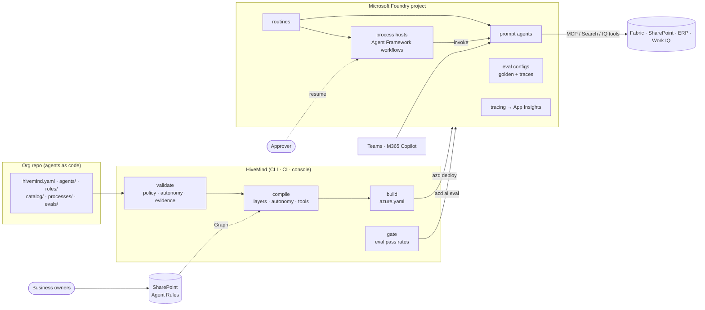

# HiveMind architecture (v0.3)

HiveMind is the **operating model** for an AI-native workforce on Microsoft Foundry. It decides *what* the digital
workers are, *how far* each may act on its own, and *what evidence* that takes. Microsoft's platform runs them.

## Principles

1. **Microsoft owns the runtime.** Agents, processes, schedules, evaluations, identity and deployment run on Foundry,
   Agent Framework, azd and Entra. HiveMind ships no service of its own.
2. **Agents as code.** Every digital worker is a reviewed, versioned spec. Its deployed form is reproducible from git,
   plus the SharePoint rules it references.
3. **Graduated autonomy.** Agents earn independence one level at a time (shadow → suggest → approve → autonomous →
   autonomous with sampling), with evidence and a named approver. The compiler enforces the level.
4. **Loop engineering.** Every agent has a golden dataset that gates promotion, and its production traces are
   evaluated continuously. Human corrections become new test cases.
5. **Processes, not agent chatter.** Work that spans agents is an explicit, testable workflow with people at the
   approval points. Agents don't delegate to each other freely.
6. **The business shapes the detail.** Non-technical owners write rules in Word on SharePoint. The platform team owns
   the structure.

## What each part does



| Layer | HiveMind | Microsoft |
|---|---|---|
| Org model | Goals, teams, roles, tool catalog with audiences, policies, environments (`schema.py`, `loader.py`) | |
| Instructions | Layered org → role → team → agent → generated sections; Word rules from SharePoint (`instructions.py`, `workspace.py`) | Foundry prompt agent instructions |
| Autonomy | Levels, environment ceilings, tool gating/removal, operating-mode instructions (`autonomy.py`) | MCP `require_approval` enforces the approvals |
| Evals | Golden datasets, gates per level, trace evaluation config, `gate` (`evals.py`) | Foundry evaluations via `azd ai eval` (`azure.ai.eval`) |
| Processes | Validation against the org, per-environment renaming, generic host (`processes.py`, `runtime/`) | Agent Framework declarative workflows; Foundry hosted agents |
| Deployment | Generates `azure.yaml` (`azd.py`) | azd: `azure.ai.project`, `azure.ai.agent`, `azure.ai.routine`, `azure.ai.eval` |
| Governance | Policy-as-code in CI (`policy.py`), inventory, console (`ui/`) | Entra Agent ID, Agent 365, Foundry Control Plane, Purview |
| Platform | Bicep for account, project, tracing, registry, deploy identity (`infra/`) | Azure Resource Manager |

## The build

`hivemind build -e <env>` writes a disposable azd project:

```
.hivemind/build/<env>/
  azure.yaml                    # schema: azd v1.0 + azure.ai.* extensions
  evals/datasets/<agent>.jsonl  # golden datasets
  processes/<name>/             # workflow.yaml (agent names per env) · main.py (host) · Dockerfile
  hivemind-build.json           # what was built: hashes, autonomy levels, git SHA
```

| Service in azure.yaml | From | Notes |
|---|---|---|
| `foundry` (`azure.ai.project`) | environment | existing `endpoint` (from the infra), model deployments per environment |
| `<agent>` (`azure.ai.agent`, `kind: prompt`) | agent spec | compiled instructions, tools in Foundry wire format, private memory, HiveMind metadata |
| `<agent>-<schedule>` (`azure.ai.routine`) | `schedules` | invokes the agent unattended |
| `<agent>-evals` (`azure.ai.eval`) | `evals` | regression eval on the golden dataset (the gate) and a production trace eval |
| `process-<name>` (`azure.ai.agent`, `kind: hosted`) | process spec | Agent Framework host built from `processes/<name>/`, `uses:` the agents it invokes |
| `process-<name>-<trigger>` (`azure.ai.routine`) | `triggers` | starts the process on a schedule |

`hivemind apply -e <env>` builds and runs `azd deploy --all`. The tests validate the generated `azure.yaml` against
azd's published JSON schemas (vendored under `tests/fixtures/azd-schemas`).

## Compilation

```
org constitution ──┐
role ──────────────┤                     ┌── operating mode (autonomy)
team ──────────────┼── + SharePoint ─────┤── goals · processes · org position
agent job ─────────┘   rules per layer   └── tools & knowledge · when to stop and escalate
                                                     │
catalog tools ── audience check ── autonomy (gate/hold write tools) ── Foundry tool JSON
                                                     │
                       definition + description + schedules ── sha256 ── hm_hash (drift detection)
```

## Autonomy

| Level | Write tools | Instructions say | Evidence (defaults) |
|---|---|---|---|
| `shadow` | removed | do the work, state what you would do, take no action | none |
| `suggest` | removed | recommend actions for a person to take | 5 cases, 70% |
| `approve` | MCP: `require_approval: always`; others removed | act; each change is approved by a person | 10 cases, 80%, approver |
| `autonomous` | as catalogued | act within your tools and policies | 30 cases, 95%, approver |
| `autonomous_sampled` | as catalogued | as autonomous; a sample of work is reviewed | 30 cases, 95%, approver, sample rate |

New agents default to `shadow`. Each environment has a `max_autonomy` ceiling: the example caps production at
`approve` until the pilot is signed off. See [autonomy-and-evals.md](autonomy-and-evals.md).

## Processes

A process is an Agent Framework declarative workflow (`kind: Workflow`, Microsoft's format) plus a HiveMind spec
(owner, goal, triggers, budget). HiveMind checks:

- every `InvokeAzureAgent` names an active agent
- if any agent below `autonomous` takes part, the workflow has a human step (`RequestExternalInput` or `Question`)
- agents in `shadow` don't drive live processes

At build time it renames agents for the environment and packages the workflow with the generic **process host**
(`runtime/process_host.py`). The host is an `azure-ai-agentserver-invocations` app that runs the workflow, calls
each step's Foundry agent with `FoundryAgent`, and pauses at human steps:

```
POST /invocations {"input": "..."}                         → {"status": "awaiting_input", "session", "requests": [...]}
POST /invocations {"session": "...", "responses": {...}}   → {"status": "completed", "outputs": [...]}
```

Paused runs live in the host's memory for the session, so approvals must arrive within the hosted agent's session
lifetime. Durable checkpoints are on the roadmap. Foundry's own workflow agents are being retired on 1 December 2026
in favour of Agent Framework, which is why processes target Agent Framework.

## Identity and access

- **Agents** use Foundry's Microsoft Entra agent identities: one shared project identity for unpublished agents,
  and a dedicated identity for each published agent. Publishing changes the identity, so downstream role
  assignments must be repeated. `hivemind identities` lists them.
- **Process hosts** call agents with their hosted-agent identity (`DefaultAzureCredential` in the container).
- **Deployments** use GitHub OIDC with a least-privilege managed identity (`infra/modules/deploy-identity.bicep`).
  Production requires the GitHub environment's reviewers and a passing dev gate.
- **Tool credentials** stay in Foundry project connections. Specs reference connections by name.
- **SharePoint**: the deploy identity has `Sites.Selected` on the HiveMind site only.
- **Data boundaries**: tool and knowledge audiences in the catalog. User-permission trimming stays with the source
  (SharePoint, Work IQ) through `user_context` tools.

## Environments

`environments:` in `hivemind.yaml`: provider (`local` or `foundry`), deploy engine (`azd`, or `sdk` as a fallback),
project endpoint, name prefix, `variables` for catalog substitution, model deployments and overrides,
`max_autonomy`, disabled agents, and `protected` (read-only in the console; changes only through CI).

## What was removed in v0.3, and why

v0.2 had its own runtime: a "hub" MCP server for delegation, escalation, review and shared memory, plus a task queue
in a SharePoint list. It was retired because it put custom code in every agent's critical path, and Microsoft now
covers the need:

- **Orchestration** is now Agent Framework workflows (processes).
- **Agent-to-agent calls** happen only as explicit process steps.
- **Memory** is each agent's Foundry memory store.
- **Outputs** come from catalog tools (OneDrive/SharePoint MCP).
- **Approvals** are process human steps and MCP `require_approval`.
