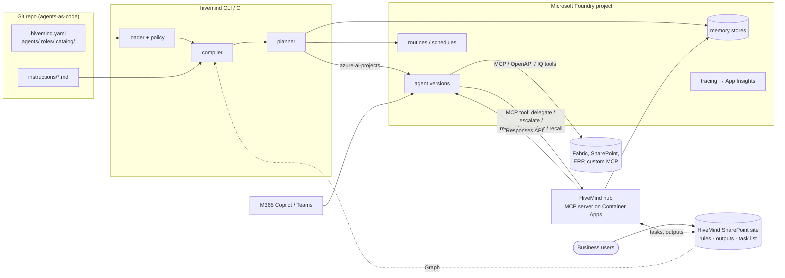

# HiveMind architecture

## Principles

1. **Foundry first, build last.** Use a Microsoft capability whenever one exists. HiveMind only builds what's
   missing: the org model, the compiler, the hub and fleet governance.
2. **Agents as code.** Every agent is a reviewed, versioned file. The deployed agent is always reproducible from
   git plus the SharePoint documents it references.
3. **One framework, many agents.** Adding an agent means adding configuration, never a custom build.
4. **The org chart is the security model.** The same hierarchy that writes "you report to…" into an agent's
   instructions also decides, at runtime, whom it may delegate to, escalate to and share memory with.
5. **Tool-agnostic.** Agents reference tools by catalog id. Fabric, SharePoint, your ERP's MCP server or a
   future Foundry tool type are all catalog entries; nothing in the core knows about specific systems.

## Components



| Component | What it does | Where |
|---|---|---|
| Org model | Pydantic models for org, teams, roles, tools, knowledge, agents | `schema.py`, `loader.py` |
| Instruction composer | Layers org → role → team → agent → generated sections; fetches SharePoint and URL sources | `instructions.py` |
| Compiler | Produces the Foundry `PromptAgentDefinition` JSON, the content hash and metadata | `compiler.py` |
| Policy | Governance rules that block or warn in CI | `policy.py` |
| Planner | Diffs the content hash against deployed metadata, then creates new versions | `planner.py` |
| Providers | `foundry` (azure-ai-projects) and `local` (JSON file, for tests and trials) | `providers/` |
| Hub | MCP server granted to every agent, enforcing org-chart rules at runtime | `hub/service.py`, `hub/server.py` |
| Task queue | Delegations, escalations and reviews as tasks, in a SharePoint list | `tasks.py`, `hub/worker.py` |
| Hub authentication | Entra agent identity tokens (production) or a shared key (development) | `hub/auth.py` |
| SharePoint site | Business-owned rules (Word), agent outputs, the task list; provisioning | `workspace.py`, `sharepoint.py`, `graph.py`, `docx.py` |
| Reporting | Inventory, budgets, org chart; KQL for usage and cost | `reporting.py`, `observability/` |

## What we use from Microsoft, and what we build

| Capability | Microsoft provides | HiveMind adds |
|---|---|---|
| Agent runtime, model hosting, threads | **Foundry Agent Service** (prompt agents, Responses API) | Nothing |
| Agent versioning | Foundry agent **versions** (immutable, with metadata) | Content-hash change detection, git SHA in metadata |
| Tools | Foundry tools: **MCP**, OpenAPI, Azure AI Search, SharePoint, Fabric data agent, Work IQ, Fabric IQ, code interpreter, web search, A2A | A catalog with ids, audiences and read/write classification, and per-environment connections |
| Connections and secrets | Foundry **project connections** (Key Vault-backed) | References by name, resolved to ids at deploy |
| Long-term memory | Foundry **memory stores** (`memory_search` tool) | Private store per agent; governed shared scopes via the hub |
| Multi-agent | Foundry workflows and A2A | A hierarchy-aware hub: delegation limited to reports and collaborators, escalation, review, bounded depth |
| Unattended runs | Foundry **routines** (cron triggers that invoke an agent) | Declared per agent as `schedules:` |
| Teams and M365 Copilot | Foundry **publish to Microsoft 365** | Declared per agent as `channels.m365`; `hivemind publish` |
| Identity | **Microsoft Entra Agent ID**: a shared project identity for unpublished agents, a dedicated identity per published agent, and agentic-identity connections for calling MCP servers | The hub verifies those tokens and maps identities to agents; `hivemind identities` lists them for RBAC |
| Business-facing UI | **SharePoint**, Teams, Lists, M365 Copilot | A provisioned site: rules folders per org/role/team/agent, outputs library, task list with an agent drop-down |
| Observability | Foundry **tracing** to Application Insights; Foundry evaluations | KQL for per-agent cost; hub audit log |
| Fleet governance | Foundry **Control Plane**, Azure Policy, Cost Management, Agent 365 | Owners, budgets, cost centres and hierarchy as agent metadata, so these tools can slice by them; policy checks before deploy |
| CI/CD auth | GitHub OIDC → Entra workload identity | Deploy workflow |

Some of this overlaps with Foundry Control Plane and Agent 365. The intent is to **feed** them rather than
compete with them: every HiveMind agent carries `managed_by`, `hm_owner`, `hm_team`, `hm_tier`,
`hm_cost_center`, `hm_budget_usd`, `hm_reports_to` and `hm_git_sha` metadata, which those tools display and
filter on.

## How an agent is compiled

```
defaults.instructions ─┐
role.instructions ─────┤
team.instructions ─────┼─► composed instructions ─┐
agent.instructions ────┤   (+ org position,       │
(SharePoint/URL/file)  ┘    tools, hub usage)     │
                                                  ├─► PromptAgentDefinition ─► sha256 ─► hm_hash
defaults/role/team/agent tools + knowledge ─► catalog ─► Foundry tool JSON ─┤
hub MCP tool (x-hivemind-agent header) ───────────────────────────────────┤
memory_search tool (private store) ───────────────────────────────────────┘
```

* **Inheritance** is additive and ordered: org defaults, then role, then team, then the agent.
* **Generated sections** come from the org chart, so they never go stale. Adding a report updates the manager's
  instructions on the next `apply`, and `plan` shows the manager as changed.
* **The hash** covers the full definition, the description and the schedules. Anything that would change agent
  behaviour creates a new version; nothing else does.

## Hierarchy and the hub

Relationships are declared on the agent:

* `reports_to`: the manager. Managers **delegate** to reports; reports **escalate** to managers.
* `reviewed_by`: an independent reviewer. The agent **requests review** before consequential actions.
* `collaborates_with`: peers who may hand work to each other, in both directions.

Tiers (`executive`, `manager`, `reviewer`, `worker`) come from the role and drive defaults and policy, for
example who may write to `org` memory.

The **hub** is a small stateless MCP server (deploy it to Azure Container Apps) that every agent gets as a tool.
It loads the same org directory, so runtime permissions always match what the agents were told:

| Tool | Allowed |
|---|---|
| `delegate_task(to, task, context, parent_task, goal)` | `to` is a direct report or collaborator |
| `escalate(issue, context)` | goes to `reports_to` |
| `request_review(work, criteria)` | goes to `reviewed_by`; answer starts with APPROVED / CHANGES REQUIRED |
| `check_task(id)` / `my_tasks()` | tasks you requested or were assigned |
| `save_output(title, content)` | your own folder in the outputs library |
| `remember(scope, content)` / `recall(scope, query)` | scope ACLs (below) |
| `list_colleagues()` | everyone, with your relationship to each |

## Tasks: the queue between agents (and people)

Delegation, escalation and review don't call the other agent directly. They create a **task**:

```
finance-manager ──delegate_task──► [Agent Tasks list]  T-41 Queued → ap-clerk
                                         │
                           hub task runner claims T-41 (ETag compare-and-set, 15-min lease)
                                         │
                                         ▼
                      Foundry Responses API → ap-clerk → result recorded on T-41 (Done)
                                         │
             ┌───────────────────────────┴────────────────────────────┐
   finance-manager was still waiting (≤ wait_seconds)       nobody waited
   → gets the result as the tool's answer                   → follow-up task T-42 → finance-manager
                                                              ("Result of T-41… continue T-40")
```

* **One assignee and one claim.** Claims are compare-and-set, so hub replicas never double-work a task. A worker
  that dies leaves its lease to expire, and the task is retried up to `max_attempts`.
* **Exactly-once delivery.** A result goes either to the waiting caller or, after a grace period, to a follow-up
  task, never both.
* **Traceability.** Each task records its `parent` (the task it serves), its `root` (the original request), its
  `goal` (inherited down the chain) and its `depth`. Agents see the goal ancestry and parent in the task message.
* **Runaway protection that survives restarts and replicas.** Depth is stored on the task (`max_delegation_depth`),
  and the number of tasks per root request is capped (`max_tasks_per_request`).
* **People use the same queue.** In the SharePoint list, people pick an agent from a drop-down, write
  instructions and read the result. Human-created items become tasks with depth 0.
* **Per-agent concurrency** (`max_concurrent_tasks`) per replica.

The queue lives in a **SharePoint list** because that's where non-technical users already are. At high volume
(thousands of tasks an hour), swap in a Service Bus or Cosmos DB backed `TaskStore`; the interface is five methods.

**Why a hub instead of only Foundry workflows or A2A?** Workflows suit fixed processes, and A2A suits
point-to-point calls. Neither knows your org chart, enforces "only your manager", or shares governed memory.
The hub is the one piece of runtime HiveMind owns. It sits behind a standard MCP interface, so agents could
later reach it through a Foundry toolbox or replace it with a native capability without changing their specs.

## The SharePoint site

`hivemind sharepoint provision` creates the business-facing side of HiveMind (see
[business-users.md](business-users.md)):

* **Agent Rules**: folders `Organisation/`, `Roles/<role>/`, `Teams/<team>/` and `Agents/<agent>/`. Word, .md and
  .txt files are appended to the matching instruction layer at compile time, in file-name order, with Word
  headings and lists converted to markdown. Files starting with `_` are ignored. Their content is part of the hash,
  so an edit appears in `plan` and produces a new agent version. `.github/workflows/sync-rules.yml` applies
  approved edits hourly. Turn on content approval in the library so only approved versions are used.
* **Agent Outputs**: `save_output` writes Word documents to `<team>/<agent>/<yyyy-mm>/`.
* **Agent Tasks**: the task queue, with an AssignedAgent drop-down of active agents (refreshed on each provision).

The deploy identity needs `Sites.Selected` read on the site, and the hub's managed identity needs write.

## Memory model

| Layer | Backed by | Scope | Who |
|---|---|---|---|
| Private | Foundry memory store `<agent>-memory`, via the native `memory_search` tool | per end user (`private_scope: user`) or per agent | the agent only |
| Team | Shared Foundry memory store, via the hub | `team:<team>` | members read/write; managers above them read |
| Org | Shared store, via the hub | `org` | everyone reads; executives and managers write (configurable) |
| Custom | Shared store, via the hub | e.g. `month-end-close` | read/write selectors; agents opt in with `memory.shared` |

Knowledge (documents, data) is separate from memory. It is grounded through SharePoint, AI Search or Fabric tools,
with **audiences** that decide which agents get which sources.

## Environments

`environments:` in `hivemind.yaml` defines targets (`local`, `dev`, `prod`…). Each has a Foundry project endpoint,
an optional name prefix (for example `dev-`), `variables` for `${var:NAME}` substitution in the catalog (so dev and
prod point at different connections and servers), model overrides (for example cheaper models in dev) and
agents to disable. Use **separate Foundry projects** per environment where possible; the prefix is for sharing one
project.

## Trust boundaries

* **Deploying** needs Entra-authenticated access to the Foundry project. CI uses OIDC; no secrets in the repo.
* **Tool credentials** live in Foundry project connections (Key Vault). Specs only reference connection names.
* **Agent identity (Microsoft Entra Agent ID).** Foundry gives every project a shared agent identity, used by
  unpublished agents, and each *published* agent its own identity. HiveMind uses these rather than inventing its own:
  * The hub tool uses an **agentic-identity project connection**, so Foundry calls the hub with an Entra token
    for the agent's identity. The hub validates it (issuer, audience, signature, tenant) and maps the principal id to
    agents using Foundry's own agent records.
  * **Published agent**: the token alone identifies it, and a mismatching `x-hivemind-agent` header is rejected.
  * **Unpublished agents** share the project identity. The token proves "an agent of this project"; the header
    (written at deploy time, not chosen by the model) names which one, and it can only name an agent that uses
    that identity. Publish an agent to give it a fully distinct identity.
  * Publishing changes an agent's identity, so its RBAC on downstream resources must be granted again.
    `hivemind identities -e prod` lists each agent's principal id for those role assignments.
  * `hub.auth: key` (shared key plus header) remains for local development.
* **Write tools** must have a reviewer or MCP `require_approval` (enforced by policy). Approvals for
  `require_approval: always` tools surface to the human in Foundry, Teams and M365.
* **Data boundaries**: tool and knowledge audiences stop an agent being granted data it shouldn't see. Runtime
  enforcement of user-level permissions stays with the source (SharePoint permissions, Fabric RLS, on-behalf-of
  auth), which is why Microsoft-native tools are preferred.

## Scaling

* **More agents** means more YAML. Compilation is pure and runs in milliseconds; `apply` only touches changed agents.
* **More teams** should own their agent folders through CODEOWNERS. Org-level files stay with the platform team.
* **More orgs or business units**: one org directory per Foundry project, or a shared catalog repo plus per-BU
  org directories.
* **Hub**: stateless HTTP and a shared task store, so scale horizontally on Container Apps. Every replica runs a
  task runner; claims are atomic. Per-agent concurrency limits are per replica.
* **Task volume**: a SharePoint list comfortably handles the volume of business tasks (with indexed Status,
  AssignedAgent and RootTask columns). Archive Done items periodically, or swap the `TaskStore` for Service Bus.
