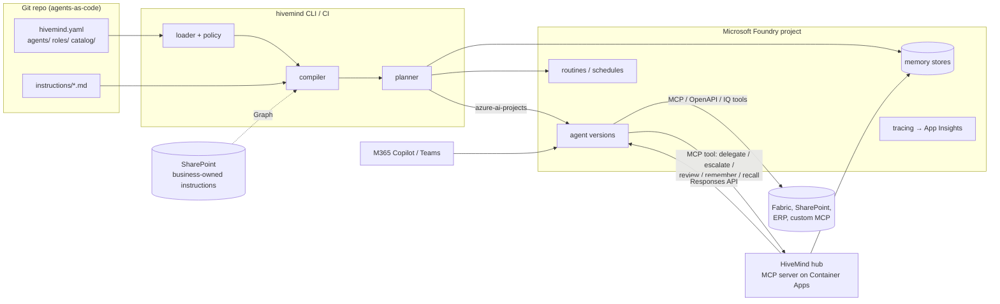

# HiveMind architecture

## Principles

1. **Foundry first, build last.** Use a Microsoft capability whenever one exists. HiveMind only builds what's
   missing: the org model, the compiler, the hub and fleet governance.
2. **Agents as code.** Every agent is a reviewed, versioned file. The deployed agent is always reproducible from
   git plus the SharePoint documents it references.
3. **One framework, many agents.** Adding an agent means adding configuration, never a custom build.
4. **The org chart is the security model.** The same hierarchy that writes "you report to…" into an agent's
   instructions also decides, at runtime, whom it may delegate to, escalate to and share memory with.
5. **Tool-agnostic.** Agents reference tools by catalog id. Fabric, SharePoint, your ERP's MCP server or a
   future Foundry tool type are all catalog entries; nothing in the core knows about specific systems.

## Components



| Component | What it does | Where |
|---|---|---|
| Org model | Pydantic models for org, teams, roles, tools, knowledge, agents | `schema.py`, `loader.py` |
| Instruction composer | Layers org → role → team → agent → generated sections; fetches SharePoint and URL sources | `instructions.py` |
| Compiler | Produces the Foundry `PromptAgentDefinition` JSON, the content hash and metadata | `compiler.py` |
| Policy | Governance rules that block or warn in CI | `policy.py` |
| Planner | Diffs the content hash against deployed metadata, then creates new versions | `planner.py` |
| Providers | `foundry` (azure-ai-projects) and `local` (JSON file, for tests and trials) | `providers/` |
| Hub | MCP server granted to every agent, enforcing org-chart rules at runtime | `hub/` |
| Reporting | Inventory, budgets, org chart; KQL for usage and cost | `reporting.py`, `observability/` |

## What we use from Microsoft, and what we build

| Capability | Microsoft provides | HiveMind adds |
|---|---|---|
| Agent runtime, model hosting, threads | **Foundry Agent Service** (prompt agents, Responses API) | Nothing |
| Agent versioning | Foundry agent **versions** (immutable, with metadata) | Content-hash change detection, git SHA in metadata |
| Tools | Foundry tools: **MCP**, OpenAPI, Azure AI Search, SharePoint, Fabric data agent, Work IQ, Fabric IQ, code interpreter, web search, A2A | A catalog with ids, audiences and read/write classification, and per-environment connections |
| Connections and secrets | Foundry **project connections** (Key Vault-backed) | References by name, resolved to ids at deploy |
| Long-term memory | Foundry **memory stores** (`memory_search` tool) | Private store per agent; governed shared scopes via the hub |
| Multi-agent | Foundry workflows and A2A | A hierarchy-aware hub: delegation limited to reports and collaborators, escalation, review, bounded depth |
| Unattended runs | Foundry **routines** (cron triggers that invoke an agent) | Declared per agent as `schedules:` |
| Teams and M365 Copilot | Foundry **publish to Microsoft 365** | Declared per agent as `channels.m365`; `hivemind publish` |
| Identity | **Microsoft Entra Agent ID** (agent identities and blueprints) | Not yet; see the roadmap |
| Observability | Foundry **tracing** to Application Insights; Foundry evaluations | KQL for per-agent cost; hub audit log |
| Fleet governance | Foundry **Control Plane**, Azure Policy, Cost Management, Agent 365 | Owners, budgets, cost centres and hierarchy as agent metadata, so these tools can slice by them; policy checks before deploy |
| CI/CD auth | GitHub OIDC → Entra workload identity | Deploy workflow |

Some of this overlaps with Foundry Control Plane and Agent 365. The intent is to **feed** them rather than
compete with them: every HiveMind agent carries `managed_by`, `hm_owner`, `hm_team`, `hm_tier`,
`hm_cost_center`, `hm_budget_usd`, `hm_reports_to` and `hm_git_sha` metadata, which those tools display and
filter on.

## How an agent is compiled

```
defaults.instructions ─┐
role.instructions ─────┤
team.instructions ─────┼─► composed instructions ─┐
agent.instructions ────┤   (+ org position,       │
(SharePoint/URL/file)  ┘    tools, hub usage)     │
                                                  ├─► PromptAgentDefinition ─► sha256 ─► hm_hash
defaults/role/team/agent tools + knowledge ─► catalog ─► Foundry tool JSON ─┤
hub MCP tool (x-hivemind-agent header) ───────────────────────────────────┤
memory_search tool (private store) ───────────────────────────────────────┘
```

* **Inheritance** is additive and ordered: org defaults, then role, then team, then the agent.
* **Generated sections** come from the org chart, so they never go stale. Adding a report updates the manager's
  instructions on the next `apply`, and `plan` shows the manager as changed.
* **The hash** covers the full definition, the description and the schedules. Anything that would change agent
  behaviour creates a new version; nothing else does.

## Hierarchy and the hub

Relationships are declared on the agent:

* `reports_to`: the manager. Managers **delegate** to reports; reports **escalate** to managers.
* `reviewed_by`: an independent reviewer. The agent **requests review** before consequential actions.
* `collaborates_with`: peers who may hand work to each other, in both directions.

Tiers (`executive`, `manager`, `reviewer`, `worker`) come from the role and drive defaults and policy, for
example who may write to `org` memory.

The **hub** is a small stateless MCP server (deploy it to Azure Container Apps) that every agent gets as a tool.
It loads the same org directory, so runtime permissions always match what the agents were told:

| Tool | Allowed |
|---|---|
| `delegate_task(to, task, context)` | `to` is a direct report or collaborator |
| `escalate(issue, context)` | goes to `reports_to` |
| `request_review(work, criteria)` | goes to `reviewed_by`; answer starts with APPROVED / CHANGES REQUIRED |
| `remember(scope, content)` / `recall(scope, query)` | scope ACLs (below) |
| `list_colleagues()` | everyone, with your relationship to each |

Delegation runs the target agent through the Foundry Responses API and returns its answer. A depth limit
(`hub.max_delegation_depth`) stops runaway chains, and every call is written as a JSON audit line.

**Why a hub instead of only Foundry workflows or A2A?** Workflows suit fixed processes, and A2A suits
point-to-point calls. Neither knows your org chart, enforces "only your manager", or shares governed memory.
The hub is the one piece of runtime HiveMind owns. It sits behind a standard MCP interface, so agents could
later reach it through a Foundry toolbox or replace it with a native capability without changing their specs.

## Memory model

| Layer | Backed by | Scope | Who |
|---|---|---|---|
| Private | Foundry memory store `<agent>-memory`, via the native `memory_search` tool | per end user (`private_scope: user`) or per agent | the agent only |
| Team | Shared Foundry memory store, via the hub | `team:<team>` | members read/write; managers above them read |
| Org | Shared store, via the hub | `org` | everyone reads; executives and managers write (configurable) |
| Custom | Shared store, via the hub | e.g. `month-end-close` | read/write selectors; agents opt in with `memory.shared` |

Knowledge (documents, data) is separate from memory. It is grounded through SharePoint, AI Search or Fabric tools,
with **audiences** that decide which agents get which sources.

## Environments

`environments:` in `hivemind.yaml` defines targets (`local`, `dev`, `prod`…). Each has a Foundry project endpoint,
an optional name prefix (for example `dev-`), `variables` for `${var:NAME}` substitution in the catalog (so dev and
prod point at different connections and servers), model overrides (for example cheaper models in dev) and
agents to disable. Use **separate Foundry projects** per environment where possible; the prefix is for sharing one
project.

## Trust boundaries

* **Deploying** needs Entra-authenticated access to the Foundry project. CI uses OIDC; no secrets in the repo.
* **Tool credentials** live in Foundry project connections (Key Vault). Specs only reference connection names.
* **The hub** authenticates callers with a key held in a Foundry "custom keys" connection (`x-hivemind-key`) and
  identifies the calling agent by the `x-hivemind-agent` header written into the agent definition at deploy time.
  The model can't change that header; only someone who can edit agent definitions in the project can. Treat the
  Foundry project as the trust boundary. Hardening, on the roadmap: validate per-agent Entra Agent ID tokens
  instead of a shared key and header.
* **Write tools** must have a reviewer or MCP `require_approval` (enforced by policy). Approvals for
  `require_approval: always` tools surface to the human in Foundry, Teams and M365.
* **Data boundaries**: tool and knowledge audiences stop an agent being granted data it shouldn't see. Runtime
  enforcement of user-level permissions stays with the source (SharePoint permissions, Fabric RLS, on-behalf-of
  auth), which is why Microsoft-native tools are preferred.

## Scaling

* **More agents** means more YAML. Compilation is pure and runs in milliseconds; `apply` only touches changed agents.
* **More teams** should own their agent folders through CODEOWNERS. Org-level files stay with the platform team.
* **More orgs or business units**: one org directory per Foundry project, or a shared catalog repo plus per-BU
  org directories.
* **Hub**: stateless HTTP, so scale horizontally on Container Apps. Delegation depth is tracked per replica,
  which is adequate for a guard; move it to a shared store if you need strict global limits.
